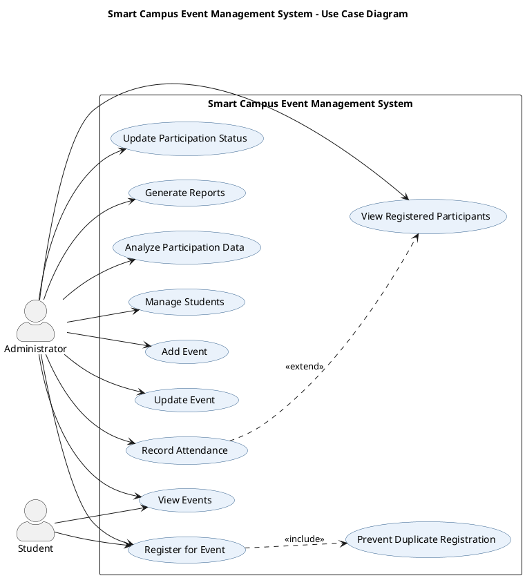
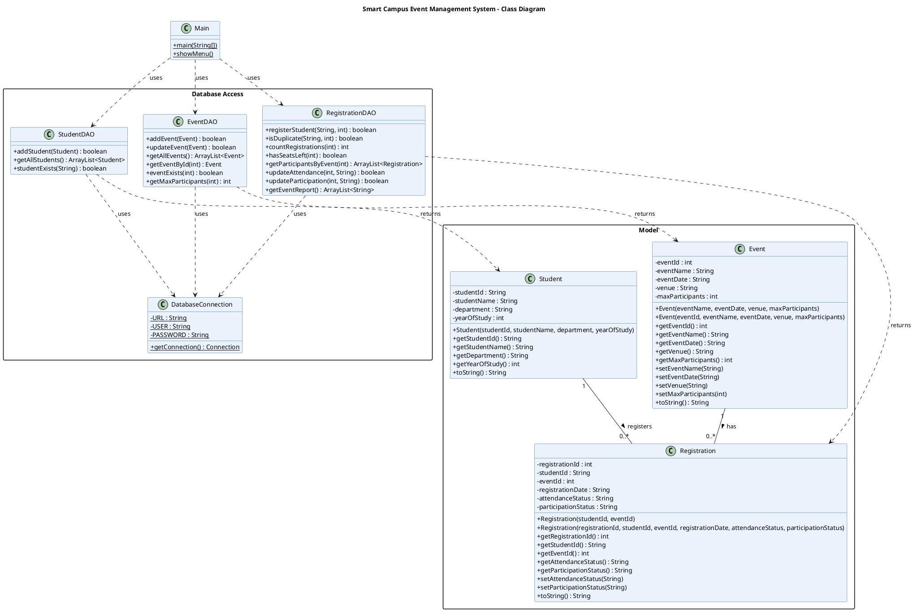
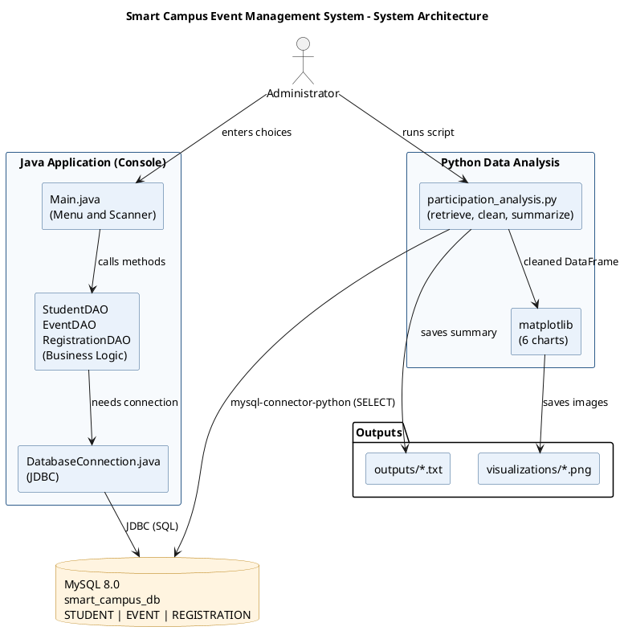
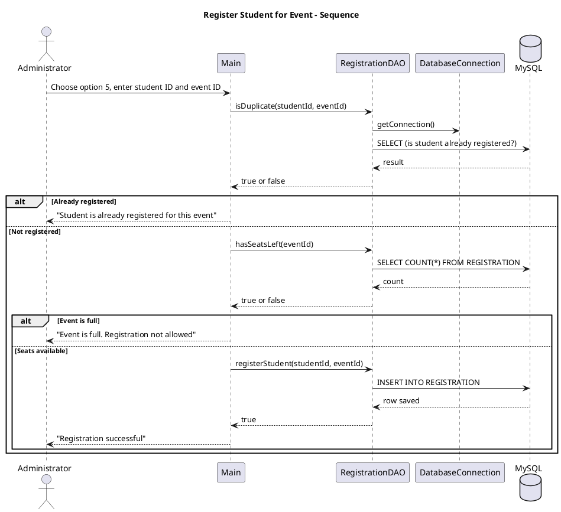

# Design Diagrams

## Smart Campus Event Management and Student Participation Analysis System

**Department:** Information Technology, Velalar College of Engineering and Technology, Erode
**Class:** 25IT3A&B | **Academic Year:** 2026-27 (Odd) | **Scenario:** 6

---

## 1. Use Case Diagram

### 1.1 Purpose

The use case diagram shows who uses the system (actors) and what they can do with it (use cases). It gives a quick overview of the system's features before any code is written.

### 1.2 Actors

| Actor | Description |
|---|---|
| Administrator | Staff or coordinator who runs the system. Manages students and events, records registrations, attendance, and results, and generates reports. |
| Student | A college student who takes part in events. In this version, students do not log in. They view events, and the administrator registers them. |

### 1.3 Use Cases

| Use Case | Actor | Description |
|---|---|---|
| Manage Students | Administrator | Add a new student and view the list of all students. |
| Add Event | Administrator | Create a new event with name, date, venue, and maximum participant count. |
| Update Event | Administrator | Change the details of an existing event. |
| View Events | Administrator, Student | Display the list of all events with their details. |
| Register for Event | Administrator (for Student) | Register a student for an event, after checking capacity and duplicates. |
| Prevent Duplicate Registration | System (included in Register for Event) | Stop a student from registering for the same event twice. |
| Record Attendance | Administrator | Mark each registered student as Present or Absent. |
| Update Participation Status | Administrator | Set the result of a student: Registered, Participated, Winner, or Runner-up. |
| View Registered Participants | Administrator | Display all students registered for a chosen event. |
| Generate Reports | Administrator | Produce an event-wise report with registered count, attended count, and seats left. |
| Analyze Participation Data | Administrator | Run the Python program to clean the data and create six charts. |

### 1.4 Use Case Diagram (PlantUML)

Paste this code into the PlantUML web editor at https://www.plantuml.com/plantuml or into draw.io (Arrange > Insert > Advanced > PlantUML).

### 1.5 Explanation of the Diagram

- **Administrator** is connected to almost every use case, because the admin runs the whole system.
- **Student** is connected only to *View Events* and *Register for Event*. The student is the one who takes part, but the admin enters the registration at the counter.
- **Prevent Duplicate Registration** is linked to *Register for Event* with an `<<include>>` arrow. This means every registration must always perform the duplicate check first.
- **View Registered Participants** is linked to *Record Attendance* with an `<<extend>>` arrow. After marking attendance, the admin can optionally view the participant list.
- **Analyze Participation Data** is the Python part. It is the only use case that does not use the Java menu directly, but it reads the same database.

### 1.6 Main Flow: Register for Event

1. Administrator selects "Register Student for Event" from the menu.
2. System asks for the student ID and event ID.
3. System checks that the student and event exist.
4. System checks for a duplicate registration (*Prevent Duplicate Registration*).
5. System checks that the event has free seats.
6. If all checks pass, the registration is saved and a success message is shown.
7. If any check fails, a clear message is shown and nothing is saved.

---

---

## 2. Class Diagram

### 2.1 Purpose

The class diagram shows the Java classes, what data each class holds (attributes), what it can do (methods), and how the classes are linked to each other. It is the blueprint for the Java code in Step 9.

### 2.2 Classes Overview

| Class | Type | Role |
|---|---|---|
| Student | Model | Holds one student's details. Matches the STUDENT table. |
| Event | Model | Holds one event's details. Matches the EVENT table. |
| Registration | Model | Holds one student's registration for one event. Matches the REGISTRATION table. |
| DatabaseConnection | Utility | Creates the connection to MySQL. Used by all DAO classes. |
| StudentDAO | DAO | Runs all SQL for the STUDENT table. |
| EventDAO | DAO | Runs all SQL for the EVENT table. |
| RegistrationDAO | DAO | Runs all SQL for the REGISTRATION table. Contains the duplicate and capacity checks. |
| Main | Controller | Shows the menu, reads input with Scanner, and calls the DAO classes. |

**DAO** means *Data Access Object*. A DAO is a class whose only job is to talk to the database. This keeps SQL out of the menu code.

### 2.3 Class Details

**Student**

| Type | Name | Notes |
|---|---|---|
| Attribute (private) | studentId | String, for example `25IT001` |
| Attribute (private) | studentName | String |
| Attribute (private) | department | String |
| Attribute (private) | yearOfStudy | int, from 1 to 4 |
| Constructor | Student(studentId, studentName, department, yearOfStudy) | Sets all four fields |
| Methods | getStudentId(), getStudentName(), getDepartment(), getYearOfStudy() | Getters |
| Methods | toString() | Returns a printable line for the menu |

**Event**

| Type | Name | Notes |
|---|---|---|
| Attribute (private) | eventId | int, created by the database |
| Attribute (private) | eventName | String |
| Attribute (private) | eventDate | String in `yyyy-MM-dd` format |
| Attribute (private) | venue | String |
| Attribute (private) | maxParticipants | int, must be greater than 0 |
| Constructor | Event(eventName, eventDate, venue, maxParticipants) | Used when adding a new event (no ID yet) |
| Constructor | Event(eventId, eventName, eventDate, venue, maxParticipants) | Used when reading an event from the database |
| Methods | getEventId(), getEventName(), getEventDate(), getVenue(), getMaxParticipants() | Getters |
| Methods | setEventName(), setEventDate(), setVenue(), setMaxParticipants() | Setters, used by Update Event |
| Methods | toString() | Returns a printable line for the menu |

**Registration**

| Type | Name | Notes |
|---|---|---|
| Attribute (private) | registrationId | int, created by the database |
| Attribute (private) | studentId | String, links to Student |
| Attribute (private) | eventId | int, links to Event |
| Attribute (private) | registrationDate | String in `yyyy-MM-dd` format |
| Attribute (private) | attendanceStatus | String: `Present` or `Absent` |
| Attribute (private) | participationStatus | String: `Registered`, `Participated`, `Winner`, or `Runner-up` |
| Constructor | Registration(studentId, eventId) | Used when registering a student. Sets attendanceStatus to `Absent` and participationStatus to `Registered` |
| Constructor | Registration(registrationId, studentId, eventId, registrationDate, attendanceStatus, participationStatus) | Used when reading from the database |
| Methods | getters for all fields | |
| Methods | setAttendanceStatus(String), setParticipationStatus(String) | Used by Record Attendance and Update Participation Status |
| Methods | toString() | Returns a printable line for the participant list |

**DatabaseConnection**

| Type | Name | Notes |
|---|---|---|
| Constant (private static final) | URL | `jdbc:mysql://localhost:3306/smart_campus_db` |
| Constant (private static final) | USER | MySQL username |
| Constant (private static final) | PASSWORD | MySQL password (change to yours) |
| Method (public static) | getConnection() | Returns a `java.sql.Connection`. Throws `SQLException` if it fails |

**StudentDAO**

| Method | Returns | Purpose |
|---|---|---|
| addStudent(Student s) | boolean | Inserts a row into STUDENT |
| getAllStudents() | ArrayList\<Student\> | Reads all rows from STUDENT |
| studentExists(String studentId) | boolean | Checks if a student ID is already in the table |

**EventDAO**

| Method | Returns | Purpose |
|---|---|---|
| addEvent(Event e) | boolean | Inserts a row into EVENT |
| updateEvent(Event e) | boolean | Updates an existing row in EVENT |
| getAllEvents() | ArrayList\<Event\> | Reads all rows from EVENT |
| getEventById(int eventId) | Event | Returns one event, or null if not found |
| eventExists(int eventId) | boolean | Checks if an event ID is in the table |
| getMaxParticipants(int eventId) | int | Returns the event's capacity |

**RegistrationDAO**

| Method | Returns | Purpose |
|---|---|---|
| registerStudent(String studentId, int eventId) | boolean | Saves a new registration after the checks pass |
| isDuplicate(String studentId, int eventId) | boolean | Returns true if the student is already registered for the event |
| countRegistrations(int eventId) | int | Counts how many students are registered for an event |
| hasSeatsLeft(int eventId) | boolean | Returns true if registered count is less than max participants |
| getParticipantsByEvent(int eventId) | ArrayList\<Registration\> | Lists all registrations for one event |
| updateAttendance(int registrationId, String status) | boolean | Sets attendance to `Present` or `Absent` |
| updateParticipation(int registrationId, String status) | boolean | Sets participation to one of the four allowed values |
| getEventReport() | ArrayList\<String\> | Returns one report line per event: registered count, attended count, seats left |

**Main**

| Method | Purpose |
|---|---|
| main(String[] args) | Starts the program and loops the menu until Exit |
| showMenu() | Prints the 10 menu options |
| addStudentMenu(), viewStudentsMenu(), addEventMenu(), viewEventsMenu() | Handle the first four menu options |
| registerStudentMenu() | Reads student ID and event ID, then calls the duplicate and capacity checks before saving |
| viewParticipantsMenu(), recordAttendanceMenu(), updateParticipationMenu(), generateReportMenu() | Handle options 6 to 9 |

### 2.4 Class Diagram (PlantUML)

Paste this code into https://www.plantuml.com/plantuml to see the diagram.

### 2.5 Explanation of Relationships

| Relationship | Meaning |
|---|---|
| Student 1 -- 0..* Registration | One student can have many registrations (one per event). A registration always belongs to exactly one student. |
| Event 1 -- 0..* Registration | One event can have many registrations. A registration always belongs to exactly one event. |
| DAO uses DatabaseConnection (dashed arrow) | Each DAO calls `DatabaseConnection.getConnection()` to get a database connection. This is a *dependency*. |
| DAO returns Model (dashed arrow) | The DAO methods return Student, Event, or Registration objects. |
| Main uses DAO (dashed arrow) | The menu calls the DAO methods. Main never writes SQL itself. |

**Why Registration stores studentId and eventId (not full Student and Event objects)?**
The database stores only the IDs in the REGISTRATION table (a foreign key). The Java object follows the same design. This keeps the code simple and matches the database exactly.

### 2.6 Design Decisions (for your viva)

1. **Encapsulation:** All attributes are `private`. Other classes must use getters and setters.
2. **Constructors:** Two constructors for Event and Registration, one for adding a new record and one for reading from the database.
3. **ArrayList:** All "get all" methods return an `ArrayList`, as required.
4. **Separation of concerns:** Models hold data, DAOs talk to the database, and Main handles input and output.
5. **Duplicate and capacity checks** happen in `RegistrationDAO` (`isDuplicate` and `hasSeatsLeft`) before `registerStudent` is called. The UNIQUE constraint in MySQL is a second safety net.

---

---

## 3. System Architecture

### 3.1 Purpose

The architecture shows how the parts of the system are arranged and how data moves between them. The system has four main parts that work together:

**User → Java Application → Business Logic → MySQL Database → Python Data Analysis → Visualizations and Reports**

### 3.2 Layers

| Layer | Part | Technology | What it does |
|---|---|---|---|
| 1. User Interface | Console menu (`Main.java`) | Java, Scanner | Shows the menu, reads the administrator's input, and displays results. |
| 2. Business Logic | DAO classes (`StudentDAO`, `EventDAO`, `RegistrationDAO`) | Java, JDBC | Applies the rules: checks that the student and event exist, blocks duplicate registrations, and blocks registration when the event is full. Then it saves or reads data. |
| 3. Data Access | `DatabaseConnection.java` | Java, JDBC, MySQL Connector/J | Opens and closes the connection to MySQL. This is the only file that holds the URL, user, and password. |
| 4. Database | `smart_campus_db` | MySQL 8.0 | Stores the STUDENT, EVENT, and REGISTRATION tables. Enforces the PRIMARY KEY, FOREIGN KEY, UNIQUE, and CHECK rules. |
| 5. Data Analysis | `participation_analysis.py` | Python, mysql-connector-python, pandas | Reads the same database, checks for missing values and duplicates, cleans the data, and prints summary statistics. |
| 6. Visualization and Reports | Six PNG charts and text reports | Python, matplotlib | Turns the cleaned data into charts saved in the `visualizations/` folder and summaries saved in `outputs/`. |

### 3.3 Architecture Diagram (PlantUML)

Paste this code into https://www.plantuml.com/plantuml to see the diagram.

### 3.4 Explanation of the Diagram

- **The administrator** uses the Java menu to change data (add, register, record attendance). The same administrator then runs the Python script to analyze that data.
- **Java never talks to Python directly.** Both programs read and write the same MySQL database. The database is the single shared source of truth.
- **Business Logic is in the DAO classes.** The menu asks the DAO to do something, and the DAO decides whether it is allowed (duplicate check, capacity check) before running any SQL.
- **DatabaseConnection is the only place with the database password.** If the password changes, only this one file is edited.
- **Python reads, it does not write.** The analysis script only runs SELECT queries, so it cannot change the data by mistake.
- **Outputs are saved as files.** The charts and summaries can be uploaded to GitHub as sample outputs.

### 3.5 Data Flow: Registering a Student (step by step)

1. The administrator chooses option 5, *Register Student for Event*, in the Java menu.
2. `Main.java` asks for the student ID and event ID, using Scanner.
3. `Main.java` calls `RegistrationDAO.isDuplicate(studentId, eventId)`.
4. `RegistrationDAO` gets a connection from `DatabaseConnection.getConnection()`.
5. `RegistrationDAO` sends a SELECT query to MySQL to check if the registration already exists.
6. If it exists, a message is shown and nothing is saved.
7. If not, `RegistrationDAO.hasSeatsLeft(eventId)` counts the current registrations and compares them with `max_participants`.
8. If the event is full, a message is shown and nothing is saved.
9. If there are free seats, `RegistrationDAO.registerStudent(studentId, eventId)` sends an INSERT query to MySQL.
10. MySQL saves the row. If the UNIQUE rule on (student_id, event_id) is broken, MySQL rejects it as a second safety check.
11. `Main.java` shows *Registration successful*.

### 3.6 Data Flow: Python Analysis (step by step)

1. The administrator runs `python participation_analysis.py`.
2. The script reads the database settings from `db_config.py`.
3. The script connects to MySQL with mysql-connector-python.
4. The script runs one JOIN query across STUDENT, EVENT, and REGISTRATION.
5. The result is loaded into a pandas DataFrame.
6. The script checks for missing values and duplicate rows, then cleans the data.
7. The script prints summary statistics to the screen and saves them to `outputs/python_summary.txt`.
8. The script creates six charts with matplotlib and saves them to `visualizations/`.

### 3.7 Sequence Diagram: Register a Student (PlantUML)

This diagram shows the same registration flow as Section 3.5, in order. Paste it into https://www.plantuml.com/plantuml.

### 3.8 Technology Summary

| Layer | Technology | Version |
|---|---|---|
| Application language | Java (JDK) | 17 or later |
| Database driver for Java | MySQL Connector/J | 8.x |
| Database | MySQL Server | 8.0 or later |
| Analysis language | Python | 3.9 or later |
| Python database driver | mysql-connector-python | Latest |
| Data cleaning | pandas | Latest |
| Charts | matplotlib | Latest |

### 3.9 Connection Details (used in Steps 9 and 10)

| Item | Value |
|---|---|
| Database name | `smart_campus_db` |
| Host | `localhost` |
| Port | `3306` |
| Java JDBC URL | `jdbc:mysql://localhost:3306/smart_campus_db` |
| Python connection | host `localhost`, port `3306`, database `smart_campus_db` |

---

