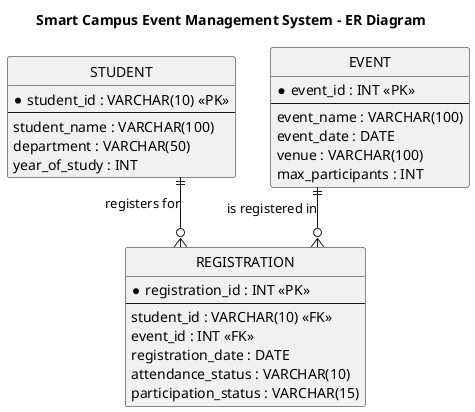

# ER Diagram and Relational Model

## Smart Campus Event Management and Student Participation Analysis System

**Department:** Information Technology, Velalar College of Engineering and Technology, Erode
**Class:** 25IT3A&B | **Academic Year:** 2026-27 (Odd) | **Scenario:** 6

---

## 1. Introduction

An **ER (Entity-Relationship) diagram** shows the main things (entities) that the system stores, the details (attributes) of each thing, and how the things are linked (relationships).

The system has three entities:

| Entity | Meaning | Database Table |
|---|---|---|
| Student | A college student | STUDENT |
| Event | A technical event, workshop, seminar, or cultural activity | EVENT |
| Registration | One student's registration for one event | REGISTRATION |

**Why is Registration a separate entity?**
A student can register for many events, and an event can have many students. This is a *many-to-many* relationship. In a database, many-to-many relationships are stored using a middle table. Here, the middle table is REGISTRATION, and it also stores the attendance and participation details.

---

## 2. ER Diagram

### 2.1 ER Diagram (PlantUML)

Paste this code into https://www.plantuml.com/plantuml to see the diagram.

### 2.2 How to Read the Diagram

| Symbol | Meaning |
|---|---|
| `* ` (asterisk) | Mandatory attribute. The value cannot be empty. |
| `<<PK>>` | Primary Key. Uniquely identifies each row. |
| `<<FK>>` | Foreign Key. Links to the primary key of another table. |
| `\|\|--o{` | One-to-many. "One" side is on the left, "zero or many" side is on the right. |

### 2.3 Relationships Explained

| Relationship | Cardinality | Meaning |
|---|---|---|
| STUDENT → REGISTRATION | 1 to 0..many | One student can register for zero or many events. Each registration belongs to exactly one student. |
| EVENT → REGISTRATION | 1 to 0..many | One event can have zero or many registrations. Each registration belongs to exactly one event. |

**Together, these two relationships form the many-to-many link between STUDENT and EVENT.**

---

## 3. Relational Model

The relational model converts the ER diagram into tables. Each table is written as:

**TABLE_NAME (attribute1, attribute2, ...)**

Primary key attributes are <u>underlined</u> in the textbook style. Here they are marked with **(PK)**. Foreign keys are marked with **(FK)** and an arrow to the table they point to.

### 3.1 Relations

**STUDENT** (**student_id** (PK), student_name, department, year_of_study)

**EVENT** (**event_id** (PK), event_name, event_date, venue, max_participants)

**REGISTRATION** (**registration_id** (PK), student_id (FK → STUDENT.student_id), event_id (FK → EVENT.event_id), registration_date, attendance_status, participation_status)

**Additional constraint on REGISTRATION:** UNIQUE (student_id, event_id)

### 3.2 Table Summary

| Table | Primary Key | Foreign Keys | Unique Constraints |
|---|---|---|---|
| STUDENT | student_id | None | None |
| EVENT | event_id | None | None |
| REGISTRATION | registration_id | student_id → STUDENT, event_id → EVENT | (student_id, event_id) |

---

## 4. Attribute Details

### 4.1 STUDENT

| Attribute | Data Type | Null? | Constraint | Example |
|---|---|---|---|---|
| student_id | VARCHAR(10) | No | PRIMARY KEY | 25IT001 |
| student_name | VARCHAR(100) | No | | Arun Kumar |
| department | VARCHAR(50) | No | | Information Technology |
| year_of_study | INT | No | CHECK (year_of_study BETWEEN 1 AND 4) | 2 |

### 4.2 EVENT

| Attribute | Data Type | Null? | Constraint | Example |
|---|---|---|---|---|
| event_id | INT | No | PRIMARY KEY, AUTO_INCREMENT | 1 |
| event_name | VARCHAR(100) | No | | AI Workshop |
| event_date | DATE | No | | 2026-12-05 |
| venue | VARCHAR(100) | No | | Seminar Hall A |
| max_participants | INT | No | CHECK (max_participants > 0) | 60 |

### 4.3 REGISTRATION

| Attribute | Data Type | Null? | Constraint | Default | Example |
|---|---|---|---|---|---|
| registration_id | INT | No | PRIMARY KEY, AUTO_INCREMENT | | 1 |
| student_id | VARCHAR(10) | No | FOREIGN KEY → STUDENT, ON DELETE RESTRICT | | 25IT001 |
| event_id | INT | No | FOREIGN KEY → EVENT, ON DELETE RESTRICT | | 1 |
| registration_date | DATE | No | | CURRENT_DATE | 2026-11-11 |
| attendance_status | VARCHAR(10) | No | CHECK (attendance_status IN ('Present', 'Absent')) | 'Absent' | Present |
| participation_status | VARCHAR(15) | No | CHECK (participation_status IN ('Registered', 'Participated', 'Winner', 'Runner-up')) | 'Registered' | Winner |
| (table) | | | UNIQUE (student_id, event_id) | | |

---

## 5. Keys and Constraints

### 5.1 Primary Keys

| Table | Primary Key | Why |
|---|---|---|
| STUDENT | student_id | Each student has a unique college ID. |
| EVENT | event_id | Auto-generated number, so two events never share an ID even if they have the same name. |
| REGISTRATION | registration_id | Each registration row needs its own ID for updating attendance and participation. |

### 5.2 Foreign Keys

| Table | Column | References | Rule |
|---|---|---|---|
| REGISTRATION | student_id | STUDENT (student_id) | ON DELETE RESTRICT: a student with registrations cannot be deleted. |
| REGISTRATION | event_id | EVENT (event_id) | ON DELETE RESTRICT: an event with registrations cannot be deleted. |

**Why RESTRICT?** It protects the data. If a student or event were deleted, all their registration and attendance records would be lost. RESTRICT makes MySQL refuse the delete, so the data stays safe.

### 5.3 Unique Constraint (Duplicate Prevention)

**UNIQUE (student_id, event_id)** on REGISTRATION means:

- The same student cannot appear twice for the same event.
- A student can still register for different events, because the pair (student_id, event_id) is different each time.

This is the database-level protection against duplicate registrations (requirement FR-09). The Java code also checks for duplicates first, so the user gets a friendly message.

### 5.4 Check Constraints (Valid Values)

| Table | Column | Rule |
|---|---|---|
| STUDENT | year_of_study | Must be from 1 to 4 |
| EVENT | max_participants | Must be greater than 0 |
| REGISTRATION | attendance_status | Must be `Present` or `Absent` |
| REGISTRATION | participation_status | Must be `Registered`, `Participated`, `Winner`, or `Runner-up` |

### 5.5 Not Null Constraints

All columns are marked NOT NULL. Columns with a DEFAULT value must still contain a value.

---

## 6. Business Rules

These are the rules the system follows. They come from the SRS.

1. A student must exist before they can register for an event.
2. An event must exist before a student can register for it.
3. A student cannot register for the same event twice.
4. A registration is not allowed if the event has reached its `max_participants`.
5. Attendance starts as `Absent` and can be changed to `Present`.
6. Participation starts as `Registered` and can be changed to `Participated`, `Winner`, or `Runner-up`.

---

## 7. Sample Data Overview

Full sample data is in `database/sample_data.sql` (Step 8). A small example:

**STUDENT**

| student_id | student_name | department | year_of_study |
|---|---|---|---|
| 25IT001 | Arun Kumar | Information Technology | 2 |
| 25IT002 | Priya Lakshmi | Information Technology | 2 |

**EVENT**

| event_id | event_name | event_date | venue | max_participants |
|---|---|---|---|---|
| 1 | AI Workshop | 2026-12-05 | Seminar Hall A | 60 |
| 2 | Code Sprint | 2026-12-10 | Computer Lab 1 | 30 |

**REGISTRATION**

| registration_id | student_id | event_id | registration_date | attendance_status | participation_status |
|---|---|---|---|---|---|
| 1 | 25IT001 | 1 | 2026-11-11 | Present | Participated |
| 2 | 25IT002 | 1 | 2026-11-11 | Absent | Registered |
| 3 | 25IT001 | 2 | 2026-11-11 | Absent | Winner |

---

